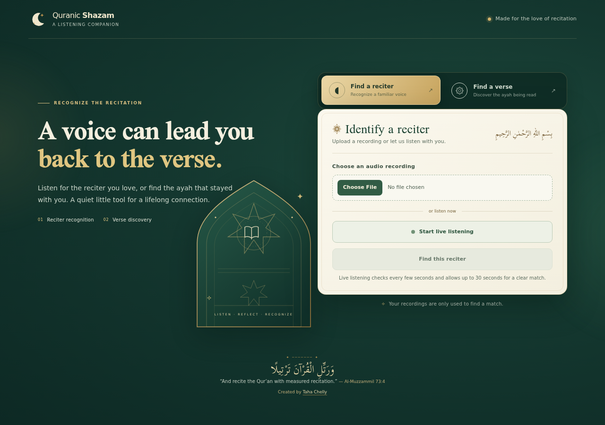
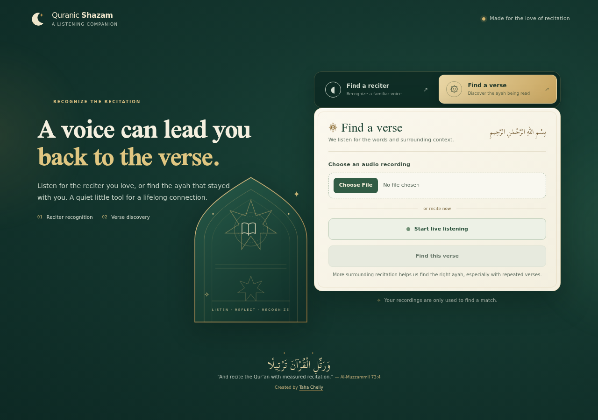

# Quranic Shazam

[](https://github.com/taha3313/quranic-shazam/actions/workflows/ci.yml)
[](https://quranicshazam.tahachelly.com/)

Identify a Qur'an reciter or discover the verse being recited. Upload a recording or use live listening from your browser.

**Try it now:** [quranicshazam.tahachelly.com](https://quranicshazam.tahachelly.com/) · [API docs](https://quranic-shazam-api.onrender.com/docs) · [API health](https://quranic-shazam-api.onrender.com/health)

## Screenshots

The screenshots below show the live app's two recognition modes.

| Reciter recognition | Verse discovery |
| --- | --- |
|  |  |

## What it does

- **Recognize a reciter:** upload up to 25 MB of audio, or listen live for a match from a set of 20 reciters.
- **Find a verse:** transcribe a recitation and rank likely surah and ayah matches. Progressive listening gathers more context when the first segment is ambiguous.
- **Protect the listening experience:** uploads are size-limited, inference runs off the async event loop, and ambiguous verse matches are reported as uncertain rather than presented as certain.
- **Run in a browser:** record through the microphone over HTTPS or choose an audio file.

## How recognition works

For reciter matching, a pretrained ECAPA-TDNN speaker-embedding model converts audio into a voice representation. The API compares that representation with precomputed profiles for 20 reciters and returns ranked matches. The embedding model runs through ONNX Runtime; it is not fine-tuned on Qur'an recordings.

For verse discovery, a Quran-tuned Whisper model transcribes Arabic recitation. The service normalizes the transcript and compares it with a 6,236-verse corpus, including partial-verse and ayah-range matches. Progressive requests can add audio context in intervals up to a 60-second listening limit.

### Offline reciter benchmark

The repository includes a **September 5, 2026** evaluation snapshot using 781 held-out clips from disjoint profile and evaluation surahs: 97.31% top-1, 99.10% top-3, and 99.62% top-5. This is a local offline benchmark, not a guarantee of accuracy on every recording or a live-service certification. See [`backend/data/eval_reports/eval_20260905T233619Z.md`](backend/data/eval_reports/eval_20260905T233619Z.md) for the report and per-reciter results.

## Reciters

Abdul Basit · Minshawi · Husary · Mustafa Ismail · Al-Banna · Sudais · Shuraim · Maher Al-Muaiqly · Al-Juhany · Al-Dosari · Alafasy · Al-Ghamdi · Al-Ajmy · Nasser Al-Qatami · Hani Ar-Rifai · Idris Abkar · Fares Abbad · Raad Al-Kurdi · Khalifa Al-Tunaiji · Abdul Rahman Al-Ossi

## API

The interactive OpenAPI page is available at [`quranic-shazam-api.onrender.com/docs`](https://quranic-shazam-api.onrender.com/docs).

| Endpoint | Purpose |
| --- | --- |
| `POST /identify_reciter?top_k=3` | Identify the reciter in an uploaded audio file. Returns ranked matches and a confidence flag. |
| `POST /identify_verse?top_k=3` | Find likely surah and ayah matches in an uploaded recitation. |
| `POST /identify_verse_progressive?top_k=3` | Analyze added listening context for ambiguous verse matches, up to 60 seconds. |
| `WS /live_reciter` | Stream microphone audio and return a reciter match when confidence is sufficient. |
| `GET /health` | Check API readiness and loaded reciter-profile count. |

Uploads use multipart form data with the audio in the `file` field. Reciter identification analyzes at most 30 seconds; standard verse identification analyzes at most 20 seconds. Set `include_transcript=true` on verse endpoints to receive the recognized Arabic transcript.

## Technology

- **Frontend:** React 19, TypeScript, Vite, Tailwind CSS 4, served by Nginx in Docker.
- **API:** Python 3.10, FastAPI, Uvicorn, Pydantic.
- **Reciter model:** SpeechBrain ECAPA-TDNN exported to ONNX Runtime, with cosine-similarity ranking.
- **Verse model:** `OdyAsh/faster-whisper-base-ar-quran` through faster-whisper/CTranslate2.
- **Deployment:** GitHub Actions runs backend tests/lint and frontend lint/typecheck/build. After both jobs pass on a push to `main`, the workflow deploys only the affected Render service. Both services use Render's free plan.

## Run locally

Requirements: Python 3.10, [`uv`](https://docs.astral.sh/uv/), Node.js 20 or newer, and FFmpeg. The reciter embedding and ONNX model files are included under `backend/data`.

Install and run the API:

```bash
cd backend
uv sync
uv run uvicorn app.main:app --reload --host 127.0.0.1 --port 8000
```

In another terminal, run the frontend:

```bash
cd frontend
cp .env.example .env
npm ci
npm run dev
```

Open [localhost:5173](http://localhost:5173). The example frontend environment file points to the local API. The Arabic Whisper model may download on the first local verse-identification request.

To run the full Nginx + API stack with Docker Compose instead:

```bash
docker compose up --build
```

Then open [localhost:8080](http://localhost:8080). More deployment notes are in [`docs/deployment.md`](docs/deployment.md); API implementation and tests are under [`backend/app`](backend/app) and [`backend/tests`](backend/tests).

## Evaluation and data tools

The reproducible data pipeline downloads recitation clips, creates speaker profiles, and evaluates recognition on held-out surahs. Some pipeline steps download substantial audio datasets.

```bash
make backend-test
make backend-lint
make data
make embeddings
make evaluate
```

See [`backend/scripts`](backend/scripts), [`AUDIT.md`](AUDIT.md), and [`PROJECT_REPORT.md`](PROJECT_REPORT.md) for evaluation and architecture details.
